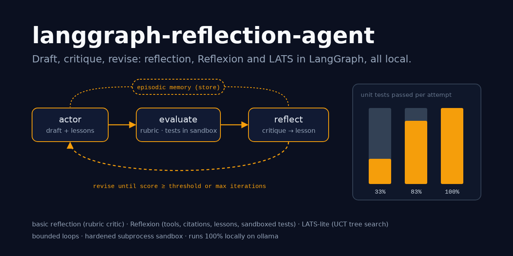
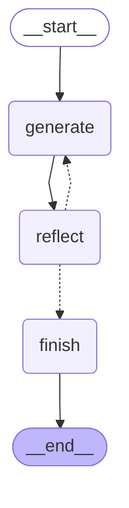
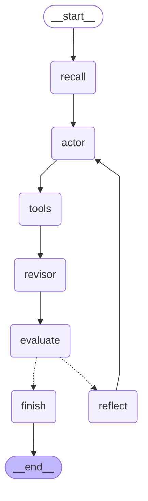
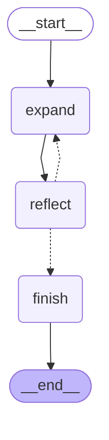
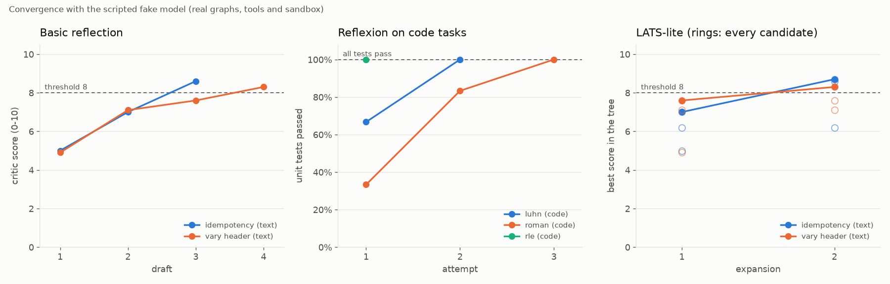

# langgraph-reflection-agent

> The reflection agent architecture in LangGraph, three ways. **Basic reflection**: a
> generator drafts, a critic scores the draft on a structured rubric, the generator
> revises until the score clears a threshold. **Reflexion**: the actor answers with a
> self-critique, looks things up with local tools, revises with citations, is judged by
> an external evaluator (unit tests in a hardened sandbox), and keeps verbal lessons in
> episodic memory across attempts. **LATS-lite**: sample several candidates, reflect on
> each, expand the most promising one by UCT, backpropagate the values.

[](https://github.com/MartinCastroAlvarez/langgraph-reflection-agent/actions/workflows/ci.yml)
[](LICENSE)
[](pyproject.toml)
[](https://github.com/langchain-ai/langgraph)
[](pyproject.toml)



**Runs 100% locally, no paid APIs required.** The default model is an open-weight model
on [ollama](https://ollama.com) (`qwen3:4b`) through `langchain-ollama`. The tools are
local: BM25 search over a bundled document collection and a calculator that walks the
AST (no `eval`). Model-written code runs only in a subprocess sandbox with no network,
no file writes, resource limits and a timeout. Anthropic is an optional adapter you can
switch on with your own key. Tests, examples and the benchmark use a scripted fake chat
model and need no model, no key and no network.

## Why

- **First drafts are rarely the best drafts.** A second pass that names concrete
  problems ("it never says what the server does with the key") and a revision that fixes
  them is the cheapest quality gain an agent can buy. The question is when to stop.
- **A model grading itself can agree with its own mistakes.** Reflexion grounds the
  loop in an *external* signal: unit tests, a calculator, retrieved documents. The
  failing assertion, not the model's mood, decides whether to try again.
- **Lessons should outlive the attempt.** Reflexion turns each failure into one short
  verbal lesson ("normalise the input with upper() first") and puts every lesson into
  the next attempt's prompt. With a LangGraph store the lessons outlive the run too: the
  second run of the same task starts with them and passes on its first attempt.
- **A single chain of revisions can get stuck.** LATS keeps several candidates alive,
  scores each one, and spends its budget on the most promising branch, so one bad first
  draft doesn't sink the search.
- **Every loop needs a hard stop.** Thresholds, iteration/attempt/expansion caps and
  tree depth are enforced by the graph, never by the model.

## Quickstart

```bash
pip install "langgraph-reflection-agent @ git+https://github.com/MartinCastroAlvarez/langgraph-reflection-agent"
ollama pull qwen3:4b
python -m reflection_agent "Explain idempotency keys for a payments API in at most three sentences."
python -m reflection_agent --variant reflexion --code-task roman --memory lessons.db    # sandboxed tests
python -m reflection_agent --provider fake --variant all "Explain idempotency keys for a payments API in at most three sentences."   # offline
```

`--variant reflect|reflexion|lats|all` picks the graph, `--code-task luhn|roman|rle`
gives Reflexion a bundled coding task with hidden unit tests, `--memory FILE` keeps its
lessons in a SQLite store, and `--mermaid <variant>` prints a graph.
`python -m examples.quickstart` runs everything offline.

~~~text
$ python -m reflection_agent --provider fake --variant reflexion --code-task luhn
[  0.002s] recall         key='task-9b6cc7bc1ab04ddb' lessons=0
[  0.003s] draft          attempt=1 queries=2
[  0.003s] tools          calls=3 evidence=5
[  0.004s] revise         attempt=1 references=['luhn']
[  0.024s] evaluate       attempt=1 passed=False score=0.667
[  0.026s] lesson         attempt=1 lesson='Lesson: validate the input before the checksum: remove spaces, then return False for any other non-digit character and f'
[  0.027s] draft          attempt=2 queries=2
[  0.027s] tools          calls=3 evidence=5
[  0.028s] revise         attempt=2 references=['luhn']
[  0.049s] evaluate       attempt=2 passed=True score=1.0
[  0.049s] finish         status='passed' best_attempt=2

[reflexion] ```python
def luhn_valid(number: str) -> bool:
    text = number.replace(" ", "")
    if len(text) < 2 or not text.isdigit():
        return False
    ...
```
  references: luhn
  status=passed score=1.0 attempts=2 tool_calls=6 recalled=0 llm_calls=5 seconds=0.053
~~~

That is a real run with the **fake** model. Its first Luhn implementation is scripted
to forget input validation; the sandbox really runs the hidden tests, two of them
really fail (`luhn_valid("0")`, `luhn_valid("059a")`), and the fake actor only writes
the fixed version once the lesson is in its prompt. With ollama, the model writes its
own code and its own lessons.

## The three variants

All three are `get_graph().draw_mermaid()` output, pasted unchanged
(`python -m reflection_agent --mermaid <variant>`).

### 1. Basic reflection: generate → reflect → revise



The reflector scores four criteria from 0 to 10 and lists issues and suggestions:

| Criterion | Weight | Question |
| --- | ---: | --- |
| accuracy | 0.4 | Is every claim correct and does it answer the task asked? |
| completeness | 0.3 | Does it cover everything the task requires? |
| clarity | 0.2 | Is it easy to follow, with concrete examples where useful? |
| concision | 0.1 | Does it respect length limits and avoid filler? |

The overall score is the weighted mean, **computed by the code, not the model**: a
critic that writes `"overall": 10` next to scores of 2 gets 2 (tested). A reply that
can't be parsed scores 0 with an issue saying so, and the loop goes on. The loop ends
when the score reaches `threshold` (`status="passed"`) or after `max_iterations` drafts
(`status="max_iterations"`), and the answer is the **best** draft, which is not always
the last one.

### 2. Reflexion: act, ground, evaluate, reflect, remember



- **`recall`** loads the task's lessons from the store (key: `--task-key`, or a hash of
  the task).
- **`actor`** answers in JSON: `answer`, `critique` (`missing`, `superfluous`),
  `search_queries`, `calculations`. It sees every lesson and the previous attempt's
  answer and evaluator feedback.
- **`tools`** runs at most `max_queries` searches and calculations locally and returns
  evidence with ids (`luhn`, `calc-1`).
- **`revisor`** rewrites the answer with the evidence and cites document ids.
  **References that weren't retrieved are dropped**, so a hallucinated citation never
  reaches the answer (tested).
- **`evaluate`** is the external signal. `UnitTestEvaluator` runs the task's hidden
  tests in the [sandbox](#the-sandbox); `CriticEvaluator` (the rubric critic) is the
  fallback for text tasks. Any object with `async evaluate(task, answer) -> Evaluation`
  plugs in.
- **`reflect`** turns the failure into one lesson, appends it to episodic memory (state,
  and the store when there is one) and loops back to the actor. Lessons are capped at
  10 × 500 characters and de-duplicated.

The run ends on a pass or after `max_attempts` attempts; the answer is the passing
attempt, otherwise the best one.

### 3. LATS-lite: tree search over reflected candidates



- **`expand`** selects a leaf by **UCT** from the root (`value/visits + c·√(ln N/visits)`,
  skipping subtrees that already reach `max_depth`), then samples `candidates` children
  in parallel (`asyncio.gather`). Each child sees the path of answers and critiques
  that led to it. Candidates are sampled at temperature 0.8 so siblings differ.
- **`reflect`** scores every new child with the rubric critic (reward = score / 10) and
  **backpropagates** the reward to all ancestors (`visits += 1`, `value += reward`).
- It stops when a child reaches `threshold`, after `max_expansions` rounds, or when the
  whole tree is at `max_depth`. The answer is the node with the **highest reflection
  score in the tree** (ties: the higher mean value), wherever it is.

*Lite* because the reward comes only from the critic: no environment rollouts, no
simulation step, and no learned value function beyond the backed-up means.

## Convergence and iterations to pass

`python -m reflection_agent.bench --json docs/benchmark/results.json --plot docs/convergence.png`
runs the real graphs, the real corpus search and calculator and the real sandbox with
the real tests. Only the model is replaced, by `FakeReflectionModel`, whose answers
improve on a script (and, for Reflexion, only when the lessons are in its prompt). So
this shows how each loop behaves and what it costs in model calls, **not** how good any
model is. Generated on 2026-10-25 on Linux, Python 3.12.3, langgraph 1.2.17, default
limits (threshold 8, 4 iterations, 3 attempts, 3 candidates, 4 expansions)
([`docs/benchmark/results.json`](docs/benchmark/results.json)):



| Task | Variant | Evaluator | Loops to pass | First | Final | Model calls | Status |
| --- | --- | --- | ---: | ---: | ---: | ---: | --- |
| idempotency (text) | reflect | rubric critic | 3 iterations | 5.0 | 8.6 | 6 | passed |
| idempotency (text) | reflexion | critic | 3 attempts | 5.0 | 8.6 | 11 | passed |
| idempotency (text) | lats | rubric critic | 2 expansions | 7.0 | 8.7 | 12 | passed |
| vary header (text) | reflect | rubric critic | 4 iterations | 4.9 | 8.3 | 8 | passed |
| vary header (text) | reflexion | critic | - (3 max) | 4.9 | 7.6 | 11 | max_attempts |
| vary header (text) | lats | rubric critic | 2 expansions | 7.6 | 8.3 | 12 | passed |
| luhn (code) | reflexion | unit tests (sandbox) | 2 attempts | 67% tests | 100% tests | 5 | passed |
| roman (code) | reflexion | unit tests (sandbox) | 3 attempts | 33% tests | 100% tests | 8 | passed |
| rle (code) | reflexion | unit tests (sandbox) | 1 attempt | 100% tests | 100% tests | 2 | passed |

What the mechanics say:

- **Basic reflection costs 2 calls per iteration** (draft + critique) and stops the
  moment the threshold is cleared.
- **Reflexion costs 2 calls per attempt plus 1 per lesson** with tests as the
  evaluator (5 calls for Luhn), and 1 more per attempt when the critic is the evaluator.
  On "vary header" its 3-attempt cap ends the run below the threshold, where basic
  reflection's 4th iteration passes: the cap, not the model, decides. When the tests
  pass on the first attempt (RLE) no reflection is spent at all.
- **LATS costs 2 × `candidates` calls per expansion** (12 here). That buys breadth:
  its first expansion already starts from the best of three drafts (7.0 instead of 5.0).
- A second Reflexion run of `roman` with a store (`--memory`) **recalls 2 lessons and
  passes on its first attempt in 2 calls** instead of 8 (tested, and shown by
  `python -m examples.quickstart`).

## The sandbox

Generated code never runs in the agent's process. `Sandbox.run(code, tests)` stacks
four layers, and the tests attack each one with the others switched off:

| Layer | What it does |
| --- | --- |
| Static policy (`check_policy`) | parses the code (never runs it) and refuses imports outside an allowlist (`math`, `re`, `collections`, `itertools`...), `open`/`eval`/`exec`/`getattr`/`globals`..., any `_private` or frame attribute (`__class__`, `gi_frame`...), and dunder method definitions (an `__eq__` that is always `True` would game `assert f(x) == y`) |
| Separate interpreter | `python -I -S -B` in a fresh temp directory, **empty environment** (no keys leak), new session, no inherited file descriptors |
| Resource limits (`resource`) | CPU seconds, address space (512 MB), file size 0 (no writes), no new processes, 32 open files, no core dumps |
| Audit hook (PEP 578) | refuses `socket.*`, `subprocess.*`, `os.system`/`fork`/`exec`/`remove`..., `ctypes`, frame introspection, imports outside the allowlist, and any file open except the one file the current phase needs |

Then a wall-clock timeout kills the process group. The report comes back on a line
prefixed with a random nonce the candidate never sees, and only the test names the
parent wrote are counted, so printing a fake "all passed" report or defining extra
`test_*` functions does nothing (tested).

**The trade-off.** The alternative is in-process: `exec` the code after the same AST
check, with stripped builtins. It's portable and much faster (microseconds instead of
~20 ms per run), but one gap in the AST filter is a full compromise of the agent's own
process, and nothing bounds CPU or memory. Python has a long history of in-process
sandbox escapes, so this package only ships the subprocess. Neither is a security
boundary against a determined attacker on a shared machine: for untrusted code at
scale, run the whole agent inside OS isolation (a container with no network, gVisor,
nsjail, or a VM). The sandbox needs POSIX (`resource`); on Windows it refuses to run.

## When to use this pattern / trade-offs

Use reflection when **quality matters more than latency** and a second look can find
concrete problems: writing that must meet constraints, code that must pass tests,
answers that must cite sources. Skip it for lookups and one-step tool calls, where a
critique only adds cost, and be wary of it with **no external signal**: a small model
reviewing itself often approves its own errors or "fixes" correct text.

| Variant | Pick it when | Cost |
| --- | --- | --- |
| Basic reflection | a rubric captures "good" and one chain of revisions converges | 2 calls per iteration; the critic is the same model, so it shares its blind spots |
| Reflexion | an external evaluator exists (tests, a checker, retrieval) and tasks recur | 2-3 calls per attempt + 1 per lesson; lessons are model output, so they can be wrong too |
| LATS-lite | first drafts vary a lot and you can afford breadth | 2 × candidates calls per expansion; the most expensive by far |

| Gain | Cost |
| --- | --- |
| Measurable improvement against a fixed rubric or real tests | Several model calls per answer instead of one |
| Lessons that make the next attempt (and the next run) cheaper | Memory can carry a wrong lesson forward until it's evicted |
| Grounding: citations checked against what was retrieved | A sandbox to build, maintain and trust |
| A search that recovers from a bad first draft | Wall-clock time grows with breadth × depth |

## Configuration

| Variable | Default | Meaning |
| --- | --- | --- |
| `REFLECTION_PROVIDER` | `ollama` | `ollama`, `anthropic` (optional extra + your key) or `fake` |
| `REFLECTION_MODEL` | `qwen3:4b` / `claude-sonnet-5-5` | model id for the provider |
| `OLLAMA_HOST` | `http://127.0.0.1:11434` | must be loopback unless the next variable is `1` |
| `REFLECTION_ALLOW_REMOTE_OLLAMA` | unset | `1` allows a non-loopback ollama |
| `REFLECTION_TEMPERATURE` | `0` | sampling temperature (LATS candidates use at least 0.8) |
| `REFLECTION_THRESHOLD` | `8` | rubric score (0-10) that passes reflection and LATS |
| `REFLECTION_MAX_ITERATIONS` | `4` | basic reflection: drafts |
| `REFLECTION_MAX_ATTEMPTS` | `3` | Reflexion: attempts |
| `REFLECTION_MAX_QUERIES` | `3` | Reflexion: searches + calculations per attempt |
| `REFLECTION_CANDIDATES` | `3` | LATS: children per expansion |
| `REFLECTION_MAX_DEPTH` | `3` | LATS: tree depth |
| `REFLECTION_MAX_EXPANSIONS` | `4` | LATS: expansion rounds |
| `REFLECTION_EXPLORATION` | `1.0` | LATS: UCT exploration weight |
| `REFLECTION_CORPUS_DIR` | bundled corpus | a folder of `.md`/`.txt` documents, one fact per bullet |
| `REFLECTION_SANDBOX_TIMEOUT` | `5` | seconds before the sandbox process group is killed |
| `REFLECTION_FAKE_LATENCY` | `0` | seconds per call for the `fake` provider |

With ollama, the critic, the actor and the revisor use JSON mode (`format="json"`). For
Anthropic, `pip install "langgraph-reflection-agent[anthropic] @ git+…"`, then set
`ANTHROPIC_API_KEY` and `REFLECTION_PROVIDER=anthropic`. The project itself never calls
a hosted API. LangSmith tracing stays off unless you set `LANGSMITH_TRACING`.

```python
from langgraph.store.memory import InMemoryStore
from reflection_agent import CODE_TASKS, Settings, build_graph

graph = build_graph("reflexion", Settings(), code_task=CODE_TASKS["luhn"], store=InMemoryStore())
final = await graph.ainvoke({"task": CODE_TASKS["luhn"].prompt, "task_key": "luhn"})
final["status"], final["trials"], final["lessons"]
```

## Testing

```bash
poetry install && poetry run pytest          # 115 tests, 96% coverage, ~6 s, offline
```

The tests drive the graphs with `FakeReflectionModel`, a real `BaseChatModel` that
reads the `Role:` line of each system prompt and answers like that node would, or
replays canned replies and exceptions. They check control flow, not prose:

- **termination:** the loop stops at the threshold (and earlier with a lower one), at
  `max_iterations`, `max_attempts`, `max_expansions` and `max_depth`, each with its own
  status; the best draft wins even when a later one is worse;
- **lessons:** every later actor and revisor prompt carries every earlier lesson;
  without lessons the actor never improves and the cap ends the run; a store hands the
  lessons to the next run of the same task key, and not to another key;
- **tree search:** breadth = `candidates`, backpropagation updates every ancestor, UCT
  trades value for exploration, exhausted subtrees are skipped, and the final answer
  is the highest-scoring node even when it came from an earlier expansion;
- **grounding:** tools respect `max_queries`, citations of documents that weren't
  retrieved are dropped;
- **the sandbox:** 17 policy refusals (sockets, `os`, `subprocess`, `ctypes`, `open`,
  `eval`, `getattr`, `__class__` chains, frames, dunder methods...), and with the policy
  **off**, the runtime layers still refuse `import socket`, `urllib`, `os.system`,
  `os.listdir('/')`, `os.remove`, reading `/etc/passwd` or the hidden tests, writing a
  file and `sys._getframe`; an infinite loop is killed by the timeout and by the CPU
  limit, a 2 GB allocation by the memory limit, the environment is empty, and forged
  reports or extra tests don't count;
- **hygiene:** an AST test bans `eval`/`exec`/`compile`/`__import__`, `shell=`,
  `pickle`/`yaml`/`ctypes`/`requests` in the package, allows `subprocess` only in
  `sandbox.py` and `runpy` only in the sandbox child, and allows exactly two `# nosec`
  markers (documented in [SECURITY.md](SECURITY.md)); the committed benchmark JSON must
  match a fresh run.

## Part of the series

| Repo | Framework | Architecture |
|---|---|---|
| [langgraph-parallel-agents](https://github.com/MartinCastroAlvarez/langgraph-parallel-agents) | LangGraph | Parallelization / map-reduce (fan-out, fan-in) |
| [langgraph-plan-and-execute](https://github.com/MartinCastroAlvarez/langgraph-plan-and-execute) | LangGraph | Planning (plan → execute → replan) |
| ✅ **langgraph-reflection-agent** | LangGraph | Reflection (Reflexion: draft → critique → revise) |
| [langgraph-short-long-term-memory](https://github.com/MartinCastroAlvarez/langgraph-short-long-term-memory) | LangGraph | Memory: short-term (checkpointer) vs long-term (store) |
| [adk-sequential-pipeline](https://github.com/MartinCastroAlvarez/adk-sequential-pipeline) | Google ADK | Sequential pipeline + generator↔critic loop |
| [adk-vertex-memory-bank](https://github.com/MartinCastroAlvarez/adk-vertex-memory-bank) | Google ADK | Long-term memory (Vertex AI Memory Bank) |
| [adk-vertex-vector-search](https://github.com/MartinCastroAlvarez/adk-vertex-vector-search) | Google ADK | Agentic RAG (Vertex AI Vector Search) |
| [crewai-hierarchical-planning](https://github.com/MartinCastroAlvarez/crewai-hierarchical-planning) | CrewAI | Hierarchical / supervisor with planning |
| [langchain-tag-agent](https://github.com/MartinCastroAlvarez/langchain-tag-agent) | LangChain | Tool-using ReAct agent with Table-Augmented Generation (TAG) |
| [langsmith-agent-evals](https://github.com/MartinCastroAlvarez/langsmith-agent-evals) | LangSmith + LangGraph | Evaluation / observability, LLM-as-judge critic |
| [agentic-architectures](https://github.com/MartinCastroAlvarez/agentic-architectures) | framework-free | Catalog: ReAct, router, sequential, parallel, loop, reflection, critic, planning, supervisor, swarm/handoff, debate, human-in-the-loop, memory |
| [s3-agent-memory](https://github.com/MartinCastroAlvarez/s3-agent-memory) | LangGraph store | Agent memory (long-term, S3) |
| [agent-model-router](https://github.com/MartinCastroAlvarez/agent-model-router) | — | Router |

More from the same author: [local-rag-ollama](https://github.com/MartinCastroAlvarez/local-rag-ollama) ·
[ui-review-agent](https://github.com/MartinCastroAlvarez/ui-review-agent) ·
[pytest-llm-evals](https://github.com/MartinCastroAlvarez/pytest-llm-evals) ·
[repo-graph-mcp](https://github.com/MartinCastroAlvarez/repo-graph-mcp) ·
[agent-lint](https://github.com/MartinCastroAlvarez/agent-lint) ·
[django-admin-mcp-api](https://github.com/MartinCastroAlvarez/django-admin-mcp-api).

## Contributing

See [`CONTRIBUTING.md`](CONTRIBUTING.md), [`ARCHITECTURE.md`](ARCHITECTURE.md),
[`SECURITY.md`](SECURITY.md) and the agent contract in [`CLAUDE.md`](CLAUDE.md).

## License

MIT © 2026 Martín Castro Álvarez. See [LICENSE](LICENSE). The bundled corpus was written
for this repository and ships under the same license; see
[`reflection_agent/data/README.md`](reflection_agent/data/README.md).
